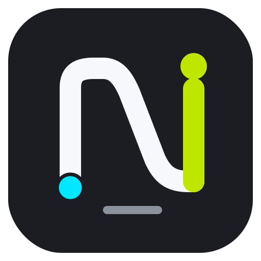
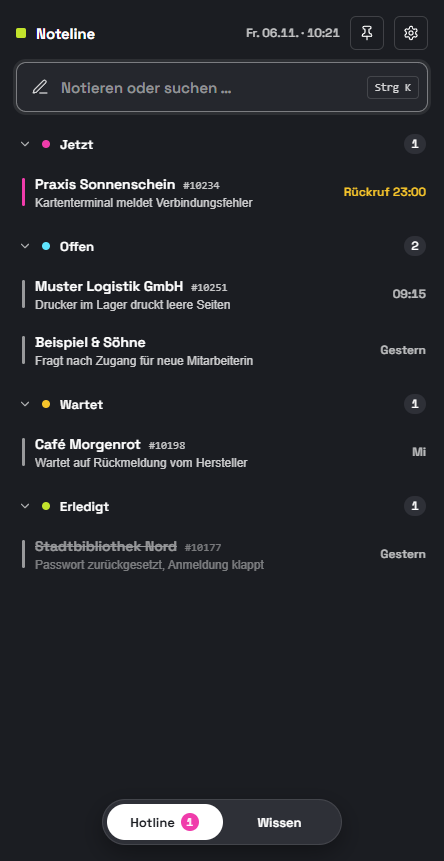
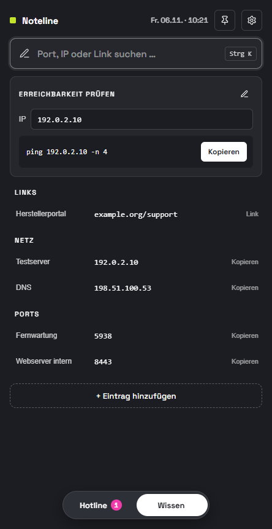

<div align="center">



# Noteline

**Schneller Notizblock und Nachschlagewerk für den Hotline-Alltag.**
Während des Anrufs mitschreiben, Rückrufe nicht vergessen, Ports und IPs mit einem Klick kopieren.
Alles bleibt lokal auf dem eigenen Rechner.

[](https://github.com/pascatotalx/noteline/actions/workflows/ci.yml)
[](https://github.com/pascatotalx/noteline/releases/latest)

[](LICENSE)


&nbsp;


</div>

## Installation

1. Unter [**Releases**](https://github.com/pascatotalx/noteline/releases/latest) die Datei `Noteline-Setup-x.y.z.exe` herunterladen.
2. Ausführen. Die Installation läuft ohne Adminrechte und legt Startmenü- und Desktop-Verknüpfung an.
3. Beim ersten Start zeigt Windows eventuell „Der Computer wurde durch Windows geschützt“, weil der Installer
   nicht signiert ist: **Weitere Informationen → Trotzdem ausführen**.

Danach aktualisiert sich Noteline selbst: Die App prüft jede Stunde auf neue Versionen, lädt sie im Hintergrund
und installiert sie per Klick auf *Jetzt neu starten* oder beim nächsten Beenden.

## Funktionen

### Hotline
- **Sofort mitschreiben:** Tippen und Enter drücken. `Kunde: Stichpunkt` füllt den Kunden gleich mit aus.
- **Spuren statt Textwüste:** *Jetzt*, *Offen*, *Wartet*, *Erledigt*, mit Priorität und Ticketnummer.
- **Rückruf-Erinnerung:** Windows-Benachrichtigung zum fälligen Zeitpunkt. Ein Klick öffnet die Notiz.
- **Suche** über Kunde, Ticket, Telefon und Text.

### Wissen
- Ports, IPs, Links und Befehle nach Gruppen. **Ein Klick kopiert** den Wert.
- **Vorlagen:** Ein Wert wie `ping <IP> -n 4` bekommt ein Eingabefeld und liefert den fertigen Befehl.

### Bedienung
- Schmales Fenster am rechten Bildschirmrand, optional immer im Vordergrund, optional mit Windows starten.

| Kürzel | Aktion |
|---|---|
| <kbd>Strg</kbd>+<kbd>K</kbd> | Suchen / notieren |
| <kbd>Strg</kbd>+<kbd>N</kbd> | Neue Notiz |
| <kbd>Strg</kbd>+<kbd>1</kbd> / <kbd>2</kbd> | Hotline / Wissen |
| <kbd>Strg</kbd>+<kbd>Alt</kbd>+<kbd>H</kbd> | Noteline aus jeder Anwendung nach vorne holen |
| <kbd>Esc</kbd> | Schließen / Suche leeren |

## Datenschutz

Noteline ist für Notizen mit Kundendaten gemacht und behandelt sie entsprechend:

- Alle Daten liegen **nur lokal** in `Dokumente\Noteline\` (`daten.json` und tägliche Backups der letzten 30 Tage).
- **Kein Upload, keine Cloud, keine Telemetrie.** Die einzige Verbindung nach außen ist die Update-Prüfung
  bei GitHub, und dabei werden keine Daten gesendet.
- Deinstallieren löscht keine Daten.
- Ist `daten.json` beschädigt, geht Noteline in einen Schutzmodus und überschreibt nichts.

## Entwicklung

Noteline wird nach **Spec-Driven Development** gebaut: Jede Änderung beginnt in [`specs/`](specs/).

| Dokument | Inhalt |
|---|---|
| [`constitution.md`](specs/constitution.md) | Feste Regeln: Zweck, Datenschutz, Technik, Sicherheit |
| [`specification.md`](specs/specification.md) | User Stories mit Akzeptanzkriterien (Was und Warum) |
| [`plan.md`](specs/plan.md) | Architektur, Datenmodell, Update- und Release-Ablauf (Wie) |
| [`tasks.md`](specs/tasks.md) | Arbeitspakete und Backlog |

```bash
npm install          # Abhängigkeiten + Git-Hook gegen sensible Daten
npm start            # App im Entwicklungsmodus
npm test             # Tests (node:test)
npm run dist         # Installer lokal bauen → dist/
npm run screenshot   # README-Screenshots mit ausgedachten Demodaten
```

**Release:** Version erhöhen (`npm version patch --no-git-tag-version`), `CHANGELOG.md` ergänzen, committen,
pushen, dann `npm run release`. Das Skript prüft alles, baut den Installer und veröffentlicht das GitHub-Release.

```
src/main/       Hauptprozess: Fenster, Speicher, Updates
src/preload/    schmale Brücke zum Renderer
src/renderer/   Oberfläche (HTML/CSS/JS ohne Framework) und reine Logik
test/           Tests
scripts/        Release, Screenshots, Prüfung auf sensible Daten
```

## Lizenz

[MIT](LICENSE) © 2026 Pascal Uffmann
