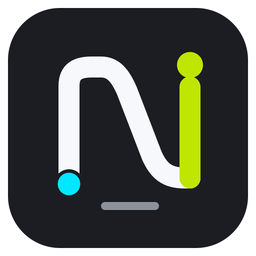
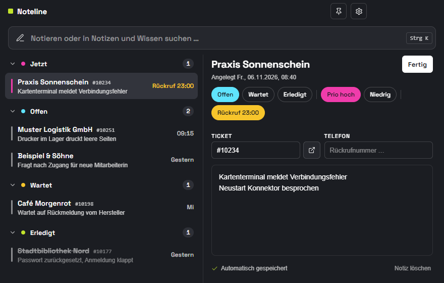
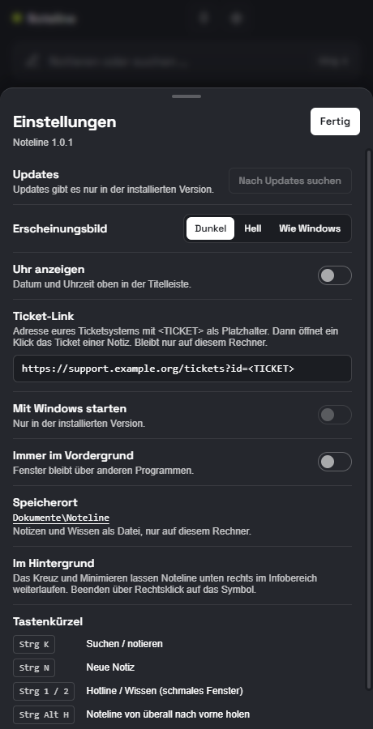
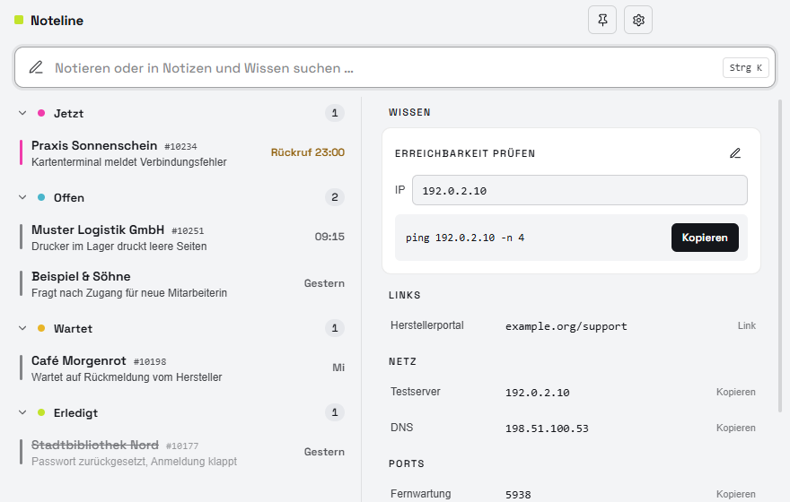
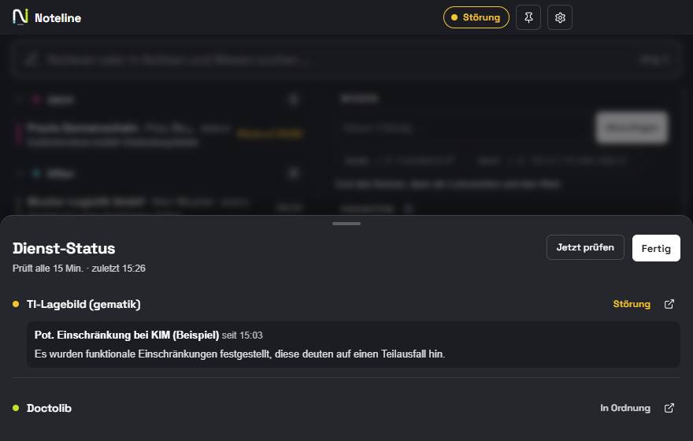

<div align="center">



# Noteline

**Schneller Notizblock und Nachschlagewerk für den Hotline-Alltag.**
Während des Anrufs mitschreiben, Rückrufe nicht vergessen, Ports und IPs mit einem Klick kopieren.
Alles bleibt lokal auf dem eigenen Rechner.

[](https://github.com/pascatotalx/noteline/actions/workflows/ci.yml)
[](https://github.com/pascatotalx/noteline/releases/latest)

[](LICENSE)



</div>

## Warum Noteline?

Ich arbeite in einer Telefon-Hotline. Während eines Anrufs kommen Informationen schnell und ungeordnet:
Name, Ticketnummer, Rückrufnummer, was schon probiert wurde. Bisher landete das alles in einer langen
Textdatei im Editor. Dort verschwimmen die Anrufe ineinander, offene Rückrufe gehen unter, und die Werte, die
ich ständig brauche (Ports, IPs, Links, Befehle), muss ich jedes Mal erst suchen.

Noteline ist mein Werkzeug dagegen: **Gedanken und Infos schnell und präzise festhalten, ohne den Faden im
Gespräch zu verlieren, und das wichtigste Nachschlagewissen immer mit einem Klick parat haben.**

## Installation

1. Unter [**Releases**](https://github.com/pascatotalx/noteline/releases/latest) die Datei `Noteline-Setup-x.y.z.exe` herunterladen.
2. Ausführen. Die Installation läuft ohne Adminrechte und legt Startmenü- und Desktop-Verknüpfung an.
3. Beim ersten Start zeigt Windows eventuell „Der Computer wurde durch Windows geschützt“, weil der Installer
   nicht signiert ist: **Weitere Informationen → Trotzdem ausführen**.

Danach aktualisiert sich Noteline selbst: Die App prüft jede Stunde auf neue Versionen, lädt sie im Hintergrund
und meldet sich per Windows-Benachrichtigung. Installiert wird per Klick auf *Jetzt neu starten*, beim Beenden
oder still in einer Pause, wenn Noteline im Infobereich liegt und der PC 10 Minuten nicht benutzt wurde.
Was sich geändert hat, steht im [Changelog](CHANGELOG.md) und bei jedem [Release](https://github.com/pascatotalx/noteline/releases).

## Funktionen

### Hotline
- **Sofort mitschreiben:** Tippen und Enter drücken. `Praxis Sonnenschein, Frau Müller, Connector startet neu` füllt Kunde,
  Ansprechpartner und Stichpunkt gleich mit aus. Eine Vorschau unter dem Eingabefeld zeigt vorher, was erkannt wird.
  Telefonnummern und `#Ticketnummern` landen automatisch in ihren Feldern. Kürzel wie `KD`, `ASP`, `Tel`, `Tkt`, `PX` (Praxis)
  und `Dr.` am Anfang werden ebenfalls verstanden, auch kleingeschrieben.
- **Ticket mit einem Klick öffnen:** Einmal die Ticket-Adresse eures Systems hinterlegen, dann wird jede
  Ticketnummer zum Link.
- **Spuren statt Textwüste:** *Jetzt*, *Offen*, *Wartet*, *Erledigt*, mit Priorität und Ticketnummer.
- **Kunden werden gemerkt:** Bekannte Kunden erkennt Noteline in voller Länge, beim Tippen schlägt es sie vor (**Tab** übernimmt).
- **TeamViewer-ID und Passwort** je Notiz mit Kopier-Knopf (`TV 123 456 789 PW …` wird erkannt). Das Passwort bleibt aus
  Suche und Text-Export heraus.
- **Ansprechpartner** je Notiz: mit wem telefoniert wurde bzw. wer beim Kunden zuständig ist.
- **Als Text kopieren:** Die ganze Notiz mit einem Klick fertig zum Einfügen ins Ticketsystem.
- **Löschen mit Rückgängig:** kein Nachfragen, dafür 6 Sekunden zum Zurückholen.
- **Rückruf-Erinnerung:** Datum steht schon auf heute, nur die Uhrzeit eintragen. Zum Zeitpunkt kommt eine
  Windows-Benachrichtigung, die stehen bleibt, bis du sie
  wegklickst. Ein Klick öffnet die Notiz.
- **Suche** über Kunde, Ticket, Telefon und Text.

### Wissen
- **Eine Zeile reicht:** `Support-Hotline 0800 1234567`, `Download https://…` oder `Feste IP setzen New-NetIPAddress …`
  eintippen, Enter. Noteline erkennt
  Telefonnummer, E-Mail, Link, IP-Adresse, Port oder Befehl und sortiert den Eintrag selbst ein, ohne Gruppen.
  Eine Live-Vorschau zeigt beim Tippen, was als Name und was als Wert erkannt wird, und schlägt passende Werte vor.
- **Ein Klick kopiert** den Wert. Links lassen sich öffnen, E-Mail-Adressen direkt anschreiben.
- **Favoriten** mit dem Stern stehen ganz oben und sind mit **Alt+1 bis Alt+9** ohne Suchen kopierbar.
- **Strg+Enter** in der Suche kopiert den besten Treffer.
- **Vorlagen:** Ein Wert wie `route add <IP> mask 255.255.255.255 <GATEWAY>` bekommt Eingabefelder und liefert
  den fertigen Befehl.

### Bedienung
- **Passt sich dem Fenster an:** schmal und hoch mit Reitern, breit und niedrig mit zwei Spalten
  (Notizen links, Wissen oder die offene Notiz rechts).
- **Läuft im Hintergrund, ohne die Taskleiste zu belegen:** Noteline erscheint nur als kleines Symbol im Infobereich
  unten rechts. Klick darauf oder Strg+Alt+H öffnet es, das Kreuz versteckt es wieder, Erinnerungen laufen weiter.
  Beenden über Rechtsklick auf das Symbol.
- **Hell, Dunkel oder wie Windows**, optional immer im Vordergrund, optional mit Windows starten.

<p align="center">

&nbsp;

&nbsp;

</p>
<p align="center"></p>

| Kürzel | Aktion |
|---|---|
| <kbd>Strg</kbd>+<kbd>K</kbd> | Suchen / notieren |
| <kbd>Strg</kbd>+<kbd>N</kbd> | Neue Notiz |
| <kbd>Strg</kbd>+<kbd>Enter</kbd> | Besten Wissens-Treffer der Suche kopieren |
| <kbd>Alt</kbd>+<kbd>1</kbd> … <kbd>9</kbd> | Favoriten kopieren |
| <kbd>Strg</kbd>+<kbd>1</kbd> / <kbd>2</kbd> | Hotline / Wissen |
| <kbd>Strg</kbd>+<kbd>Alt</kbd>+<kbd>H</kbd> | Noteline aus jeder Anwendung nach vorne holen |
| <kbd>Esc</kbd> | Schließen / Suche leeren |

## Statusmonitor (optional)

<p align="center"></p>

Im Hotline-Alltag im Gesundheitswesen bekommt man Ausfälle von Online-Diensten oft erst mit, wenn die ersten Anrufe
kommen. Deshalb kann Noteline öffentliche Statusseiten im Blick behalten:

- **Standardmäßig aus.** Wer die Funktion nicht braucht, merkt nichts davon, und es gibt keine zusätzlichen Netzwerkzugriffe.
- In den Einstellungen einschalten und Dienste anhaken. Mitgeliefert sind das
  [TI-Lagebild der gematik](https://fachportal.gematik.de/ti-status) (über die
  [offizielle TI-Status-API](https://github.com/gematik/api-tilage)) und [Doctolib](https://status.doctolib.com).
- **Eigene Dienste** lassen sich mit Name und Adresse ergänzen. Noteline erkennt Statusseiten im verbreiteten
  Statuspage-Format selbst, sonst prüft es, ob die Webseite erreichbar ist.
- Geprüft wird alle 5, 15 oder 30 Minuten. Oben in der Titelleiste zeigt ein kleines Feld den Gesamtzustand, ein Klick
  öffnet die Übersicht mit allen Meldungen.
- **Bei jeder Änderung** (neue Störung, Verschlechterung, Behebung) kommt eine Windows-Benachrichtigung, die stehen bleibt,
  bis man sie wegklickt.

## Datenschutz

Noteline ist für Notizen mit Kundendaten gemacht und behandelt sie entsprechend:

- Alle Daten liegen **nur lokal** in `Dokumente\Noteline\`: `daten.json` (Notizen und Wissen),
  `einstellungen.json` und im Unterordner `Backups` automatische Tagessicherungen der letzten 30 Tage.
- **Kein Upload, keine Cloud, keine Telemetrie.** Verbindungen nach außen sind nur die Update-Prüfung bei GitHub und,
  wenn eingeschaltet, die Abrufe der Statusseiten im Statusmonitor. Dabei werden nie eigene Daten gesendet.
- Deinstallieren löscht keine Daten.
- Ist `daten.json` beschädigt, geht Noteline in einen Schutzmodus und überschreibt nichts.

## Entwicklung

Noteline wird nach **Spec-Driven Development** gebaut: Jede Änderung beginnt in [`specs/`](specs/).

| Dokument | Inhalt |
|---|---|
| [`constitution.md`](specs/constitution.md) | Feste Regeln: Zweck, Datenschutz, Technik, Sicherheit |
| [`specification.md`](specs/specification.md) | User Stories mit Akzeptanzkriterien (Was und Warum) |
| [`plan.md`](specs/plan.md) | Architektur, Datenmodell, Update- und Release-Ablauf (Wie) |
| [`tasks.md`](specs/tasks.md) | Arbeitspakete und Backlog |

```bash
npm install          # Abhängigkeiten + Git-Hook gegen sensible Daten
npm start            # App im Entwicklungsmodus
npm test             # Tests (node:test)
npm run dist         # Installer lokal bauen → dist/
npm run screenshot   # README-Screenshots mit ausgedachten Demodaten
```

**Release:** Version erhöhen (`npm version patch --no-git-tag-version`), `CHANGELOG.md` ergänzen, committen,
pushen, dann `npm run release`. Das Skript prüft alles, baut den Installer und veröffentlicht das GitHub-Release.

```
src/main/       Hauptprozess: Fenster, Speicher, Updates
src/preload/    schmale Brücke zum Renderer
src/renderer/   Oberfläche (HTML/CSS/JS ohne Framework) und reine Logik
test/           Tests
scripts/        Release, Screenshots, Prüfung auf sensible Daten
```

## Lizenz

[MIT](LICENSE) © 2026 Pascal Uffmann

Enthaltene Bestandteile Dritter (Symbole von Lucide, Schrift Space Grotesk, Electron) sind ebenfalls frei
nutzbar. Details und Lizenztexte stehen in [THIRD_PARTY_NOTICES.md](THIRD_PARTY_NOTICES.md).
